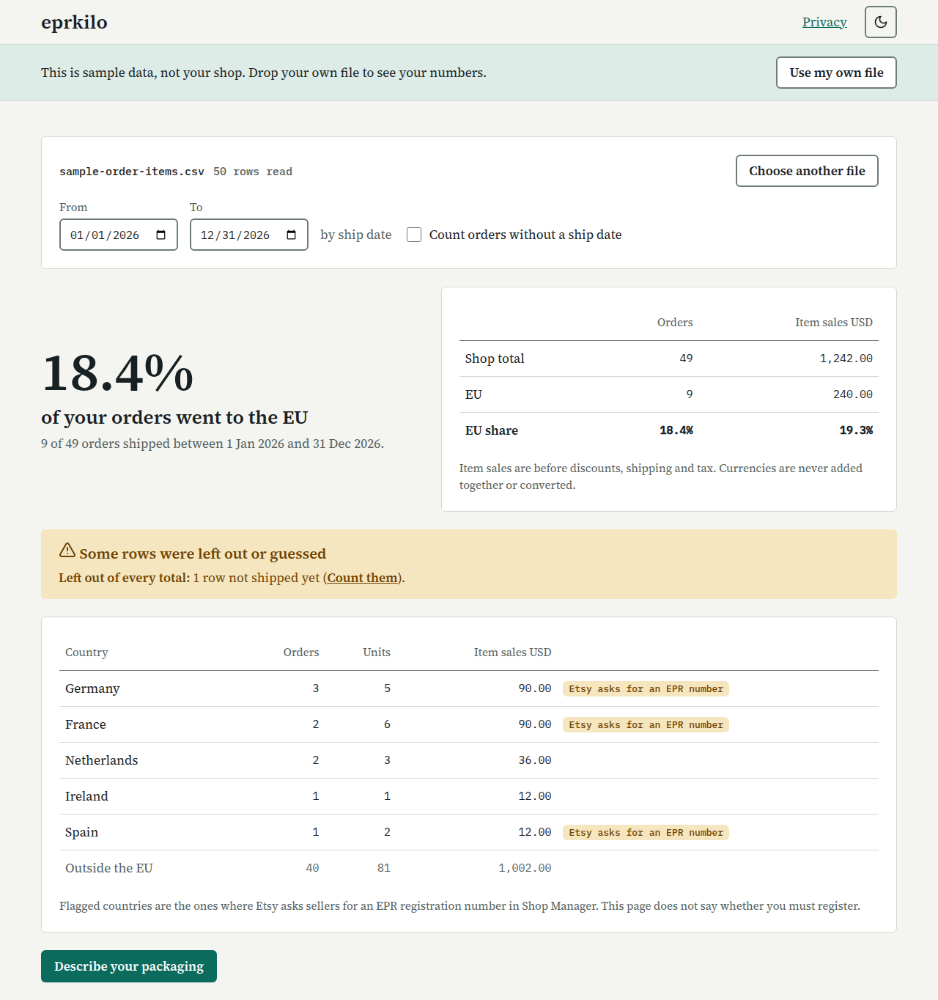

# eprkilo

Drop your Etsy order-items CSV on the page and see how much of your shop is the EU, then describe your packaging once and download kilograms per material per country for the EU packaging registers. Everything runs in your browser. The file is never uploaded.

Live: https://eprkilo.pages.dev

## Run

    npm install
    npm run dev        # no counter requests in dev
    npm test
    npm run build && npm run preview

## Deploy

The app is a static Vite build on Cloudflare Pages. The counter is a Worker with a D1 table.

    npm run build
    npx wrangler pages deploy dist --project-name eprkilo --branch main
    cd worker && npx wrangler deploy
    npx wrangler d1 execute eprkilo-counter --remote --file worker/schema.sql

The Worker accepts POST only from https://eprkilo.pages.dev, its preview subdomains and localhost ports 4173 and 5173.

## Read the counter

    npx wrangler d1 execute eprkilo-counter --remote --command "SELECT event, source, COUNT(*) AS n FROM events GROUP BY event, source ORDER BY source, event"
    npx wrangler d1 execute eprkilo-counter --remote --command "SELECT ts, source, answer FROM events WHERE event = 'switch' ORDER BY ts"

## Privacy

The page makes at most these requests, to the counter Worker. It also loads its own page and asset files from the same origin, and Cloudflare may send network error reports (NEL) about those loads. Nothing else:

- `{"event":"view","source":"direct"}` when the page opens
- `{"event":"parsed","source":"direct"}` the first time the country table appears in a tab
- `{"event":"calculated","source":"direct"}` the first time the kilogram results appear in a tab
- `{"event":"sample","source":"direct"}` when you press "Try a sample file"
- `{"event":"switch","source":"direct","answer":"..."}` only if you send the optional answer

`source` is `direct` or the `utm_source` of the link you arrived by. Without one, it can be a short name for the referring site, taken from its domain name only (for example `news.ycombinator.com` becomes `hn`), never the full address. The Worker stores the time, the event, the source and the answer. It stores no IP address, user agent or country, and does not log request bodies. It uses your IP address in memory only to limit request rate (30 per minute) and never stores it. Nothing from your file leaves the browser.

eprkilo does arithmetic on your export. It is not legal or fee advice. eprkilo is not affiliated with or endorsed by Etsy, Inc. Etsy is a trademark of Etsy, Inc.

## License

MIT. See LICENSE.
